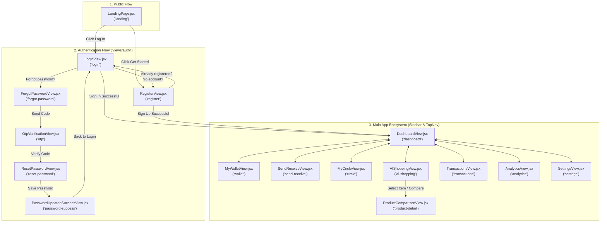

# BuyPal Frontend — Architecture, Folder Structure & Access Guide

> **PR Reference Documentation**  
> **Project:** BuyPal Web & Mobile Prototype Application  
> **Tech Stack:** React 18, Vite 5, Tailwind CSS, Lucide React  
> **Scope:** 16 Full-Fidelity Interactive Screens (Public, Auth, & App Ecosystem)

---

## 1. High-Level Directory Overview

```text
BuyPal-Frontend/
├── FOLDER_STRUCTURE_AND_ACCESS_DOC.md    # Architecture, folder structure & screen access documentation
├── README.md                             # Project overview and quick start guide
└── frontend/                             # Core Vite + React application directory
    ├── index.html                        # HTML entry point
    ├── package.json                      # NPM project manifest & scripts
    ├── package-lock.json                 # Dependency lockfile
    ├── vite.config.js                    # Vite bundler configuration
    ├── tailwind.config.js                # Tailwind CSS styling tokens & themes
    ├── postcss.config.js                 # PostCSS setup
    ├── dist/                             # Compiled production build artifacts
    └── src/                              # Source code directory
        ├── main.jsx                      # React DOM mounting entry point
        ├── App.jsx                       # Master view router & floating screen switcher
        ├── index.css                     # Global styles, fonts, and Tailwind utilities
        ├── context/                      # Global state management (Context API)
        │   └── AppContext.jsx            # Shared state for balances, user, transactions & views
        ├── components/                   # Reusable shared UI widgets & layouts
        │   ├── BuyPalLogo.jsx            # Dynamic vector logo component
        │   ├── PhoneMockup.jsx           # Realistic smartphone hardware container
        │   ├── Sidebar.jsx               # Main collapsible desktop navigation drawer
        │   └── TopNav.jsx                # Universal top header with search, bell & user menu
        └── views/                        # All application views & screen implementations
            ├── LandingPage.jsx           # Public marketing landing page
            ├── DashboardView.jsx         # Central dashboard with balance, quick actions & cards
            ├── MyWalletView.jsx          # Wallet management, cards, limits & top-ups
            ├── SendReceiveView.jsx       # P2P money transfers, UPI & payment requests
            ├── MyCircleView.jsx          # Shared group wallet & peer approval system
            ├── AIShoppingView.jsx        # AI-assisted shopping agent & product discovery
            ├── ProductComparisonView.jsx # Multi-merchant live pricing & spec comparison
            ├── TransactionsView.jsx      # Audit history, transaction filters & receipt drawer
            ├── AnalyticsView.jsx         # Spending analytics, category breakdown & insights
            ├── SettingsView.jsx          # Profile, security, limits & preferences
            └── auth/                     # Authentication & onboarding flow
                ├── LoginView.jsx         # User login screen
                ├── RegisterView.jsx      # New account registration
                ├── ForgotPasswordView.jsx# Password recovery initiation
                ├── OtpVerificationView.jsx# 6-digit OTP verification screen
                ├── ResetPasswordView.jsx # New password configuration
                └── PasswordUpdatedSuccessView.jsx # Confirmation and re-login redirect
```

---

## 2. What Can Be Accessed From Which Folder

### 📁 Root Directory (`/`)
| Path / File | Purpose & Access Details |
| :--- | :--- |
| `FOLDER_STRUCTURE_AND_ACCESS_DOC.md` | **Documentation:** Complete architectural guide and screen navigation matrix for code reviewers and developers. |
| `README.md` | **Project Quickstart:** Overview of the application, running instructions, and links to documentation. |
| `frontend/` | **Application Root:** Contains all React frontend source code, configuration files, dependencies, and build pipelines. |

---

### 📁 Application Configuration (`frontend/`)
| File | What It Controls |
| :--- | :--- |
| `package.json` | Project scripts (`dev`, `build`, `preview`), dependencies (`react`, `lucide-react`, `clsx`, `tailwind-merge`), and dev-dependencies (`vite`, `tailwindcss`). |
| `vite.config.js` | Vite dev server and React plugin configuration. |
| `tailwind.config.js` | Tailwind CSS configuration, content scanning paths (`./index.html`, `./src/**/*.{js,ts,jsx,tsx}`), and theme colors. |
| `postcss.config.js` | Autoprefixer and Tailwind PostCSS plugins. |
| `index.html` | Root HTML template containing `<div id="root"></div>` and entry script reference `/src/main.jsx`. |

---

### 📁 Source Core (`frontend/src/`)
| File | What Can Be Accessed Here |
| :--- | :--- |
| `main.jsx` | Mounts the React application tree into the `#root` element and wraps it with `<AppProvider>`. |
| `App.jsx` | **Central View Controller:** Handles conditional layout rendering. If in `landing` or `auth` mode, renders clean full-page layouts. If in logged-in mode, wraps screens inside `<Sidebar />` and main content. Also exposes the **Floating Prototype Navigator** (bottom-right widget) to jump to any of the 16 screens instantly. |
| `index.css` | Imports Google Inter font, Tailwind base/components/utilities, custom scrollbar rules, and elevation styling. |

---

### 📁 State Management (`frontend/src/context/`)
| File | What Can Be Accessed Here |
| :--- | :--- |
| `AppContext.jsx` | **Global App Store (`useApp()` hook):**<br>• `currentView`, `setCurrentView`: Active screen switcher.<br>• `user`, `setUser`: User profile data (name, email, phone, handle, avatar).<br>• `walletBalance`, `circleBalance`: Financial balances.<br>• `monthlyLimit`, `monthlySpent`: Budget constraints.<br>• `shoppingMode`, `setShoppingMode`: Toggles between `'assisted'` and `'autonomous'` AI shopping.<br>• `circleMembers`, `setCircleMembers`: Circle user list and individual spending limits.<br>• `pendingApprovals`, `setPendingApprovals`: Request queue for circle approvals.<br>• `transactions`, `setTransactions`: Transaction ledger history.<br>• `showBalance`, `setShowBalance`: Visibility toggle for balances. |

---

### 📁 Reusable UI Components (`frontend/src/components/`)
| Component | Where It Is Used & What Can Be Accessed |
| :--- | :--- |
| `BuyPalLogo.jsx` | Vector SVG brand icon and wordmark. Supports sizes `sm`, `md`, `lg`, and `xl`. Used in Landing Page, Sidebar, Auth headers, and Footers. |
| `PhoneMockup.jsx` | Realistic smartphone mockup container featuring dynamic island, screen frame, and centered brand logo. Used on Landing Page and marketing banners. |
| `Sidebar.jsx` | Primary desktop navigation sidebar containing BuyPal branding, navigation links to all app views, and quick link back to Landing Page. Highlights active tab dynamically. |
| `TopNav.jsx` | Universal header bar across all core app views. Features dynamic `title` and `subtitle`, universal search bar, notification bell with circle approval indicator badge, and user avatar pill that routes to Settings. |

---

### 📁 Application Views (`frontend/src/views/`)

#### A. Public & Landing
| View File | View ID | Description & Accessible Actions |
| :--- | :--- | :--- |
| `LandingPage.jsx` | `'landing'` | Public homepage highlighting BuyPal features, hero preview phone mockup, feature breakdown (AI Shopping, Circle Wallet, Instant P2P), and security assurances.<br>• Access to Login (`setCurrentView('login')`)<br>• Access to Register (`setCurrentView('register')`) |

#### B. Core Application Hubs
| View File | View ID | Description & Accessible Actions |
| :--- | :--- | :--- |
| `DashboardView.jsx` | `'dashboard'` | **Main Home Hub:**<br>• Wallet Balance Card with hide/reveal toggle.<br>• Quick Action pills: Add Money, Send, Receive, QR Pay.<br>• My Circle quick widget with live approvals.<br>• AI Shopping Agent promo banner.<br>• Recent transactions list with link to full history. |
| `MyWalletView.jsx` | `'wallet'` | **Wallet & Virtual Cards:**<br>• Virtual debit card representation with chip and quick copy.<br>• Top-up, Withdraw, and Transfer actions.<br>• Linked bank accounts and payment methods.<br>• Monthly spending limit progress bar. |
| `SendReceiveView.jsx` | `'send-receive'` | **P2P Transfer Center:**<br>• Send Money form (by Phone, BuyPal ID, or Bank Account).<br>• Amount input with quick ₹500, ₹1000, ₹2000 chips.<br>• Payment source selector (Wallet vs Circle).<br>• Receive money QR code and personal VPA sharing. |
| `MyCircleView.jsx` | `'circle'` | **Shared Family & Friend Budgeting:**<br>• Circle pooled balance and monthly spend tracker.<br>• Member management with per-user limits and permission badges.<br>• Pending approval card requests with one-click **Approve** and **Decline** triggers. |
| `AIShoppingView.jsx` | `'ai-shopping'` | **AI Shopping Assistant:**<br>• Assisted vs. Autonomous mode toggle.<br>• Smart prompt search bar (e.g., *"Find best gaming laptop under ₹75,000"*).<br>• Product recommendation cards with AI verdict badges.<br>• Direct click-through to Product Comparison (`'product-detail'`). |
| `ProductComparisonView.jsx` | `'product-detail'` | **Multi-Merchant Deal Engine:**<br>• Live side-by-side comparison across Amazon, Flipkart, Croma, and Lenovo Store.<br>• Spec sheet matrix (Processor, Display, RAM, Graphics).<br>• Lowest price highlighter, coupon alerts, and BuyPal instant checkout. |
| `TransactionsView.jsx` | `'transactions'` | **Ledger & Audit History:**<br>• Filter by All, Sent, Received, and Circle transactions.<br>• Search transactions by keyword or reference ID.<br>• Interactive slide-out receipt drawer with full payment breakdown. |
| `AnalyticsView.jsx` | `'analytics'` | **Financial Insights:**<br>• Monthly cashflow comparisons (Income vs Expense).<br>• Spending category breakdown (Shopping, Groceries, Bills, Transfers).<br>• AI-generated budget recommendations and savings tips. |
| `SettingsView.jsx` | `'settings'` | **Account & Security Settings:**<br>• Edit profile (Name, Email, Phone, Handle).<br>• Security controls (Biometric toggle, 2FA, PIN change).<br>• Notification and Circle approval preferences. |

---

### 📁 Authentication Flow (`frontend/src/views/auth/`)
| View File | View ID | Description & Navigation Transitions |
| :--- | :--- | :--- |
| `LoginView.jsx` | `'login'` | Secure login interface with email/phone input, password visibility toggle, remember me checkbox, Google/Apple social login, link to Register (`'register'`), and Forgot Password (`'forgot-password'`). Submitting transitions to `'dashboard'`. |
| `RegisterView.jsx` | `'register'` | Sign-up form with full name, email, phone, and password validation. Includes terms checkbox and transition to `'dashboard'` or `'login'`. |
| `ForgotPasswordView.jsx` | `'forgot-password'` | Password recovery form accepting registered email or phone number. Submitting triggers OTP dispatch and navigates to `'otp'`. |
| `OtpVerificationView.jsx` | `'otp'` | 6-digit numeric OTP input with automatic auto-focus, countdown timer, resend option, and route to `'reset-password'`. |
| `ResetPasswordView.jsx` | `'reset-password'` | Password reset form with new password, confirmation field, and strength indicator. Submitting routes to `'password-success'`. |
| `PasswordUpdatedSuccessView.jsx` | `'password-success'` | Confirmation banner with checkmark graphic and direct button back to Login (`'login'`). |

---

## 3. Screen Access & Navigation Matrix



> **Pro Tip:** In any view, developers and reviewers can use the **Floating Screen Navigator** (blue layer icon in the bottom-right corner) to jump directly to any of the 16 screens without needing to step through the forms.

---

## 4. How to Run & Verify Locally

1. Open terminal inside the `frontend` directory:
   ```bash
   cd frontend
   ```
2. Install dependencies (if not already installed):
   ```bash
   npm install
   ```
3. Start the Vite local development server:
   ```bash
   npm run dev
   ```
4. Open the displayed URL in your browser (typically `http://localhost:5173`).
5. To test production bundling:
   ```bash
   npm run build
   ```
